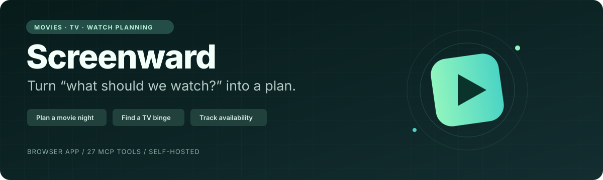
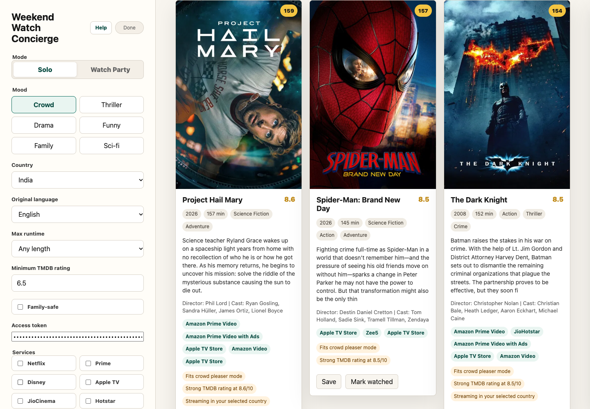
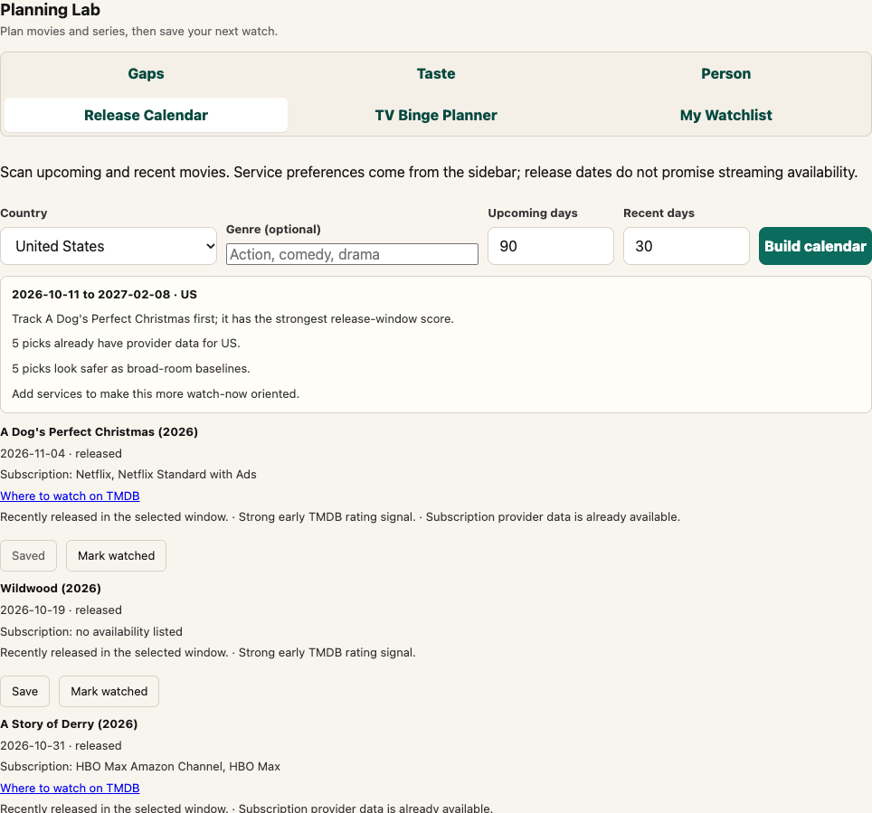
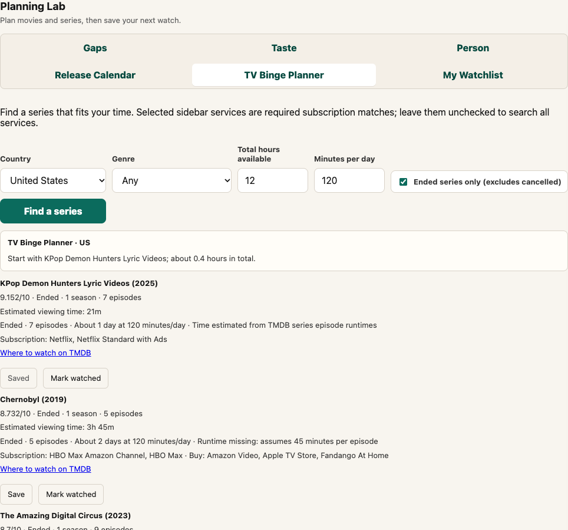
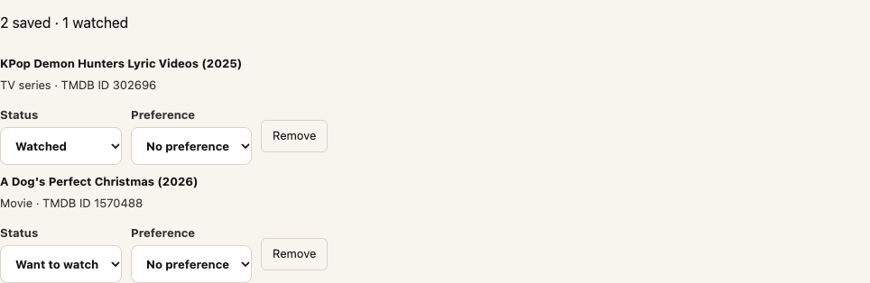
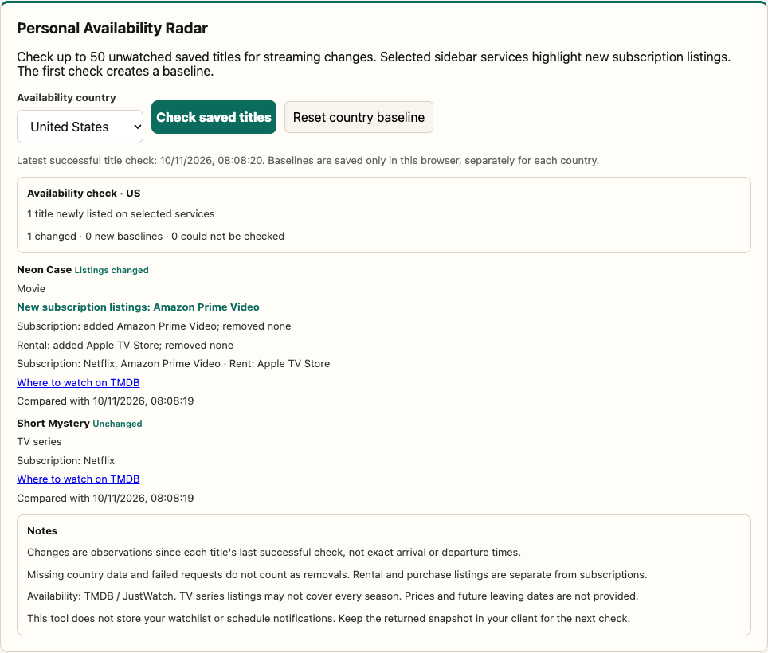
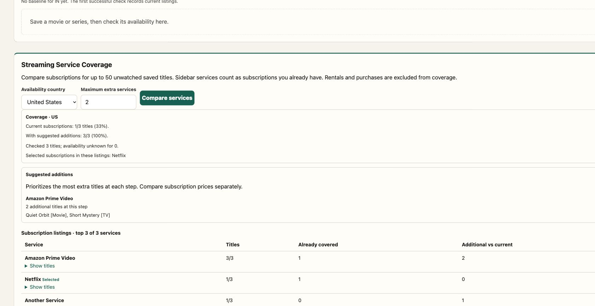

<p align="center">
  
</p>

<p align="center">
  <a href="https://github.com/Laksh-star/mcp-server-tmdb/stargazers"></a>
  <a href="https://github.com/Laksh-star/mcp-server-tmdb/network/members"></a>
  <a href="LICENSE"></a>
  <a href="#tools"></a>
</p>

<p align="center">
  <a href="#quick-start"><b>Quick start</b></a> ·
  <a href="#see-it-in-action"><b>Screenshots</b></a> ·
  <a href="#tools"><b>Tools</b></a> ·
  <a href="#remote-mcp--browser-app"><b>Deploy</b></a> ·
  <a href="CHANGELOG.md"><b>Changelog</b></a> ·
  <a href="USERGUIDE.md"><b>Architecture</b></a>
</p>

# TMDB MCP Server

**Turn “what should we watch?” into a plan.** Discover movies and TV, compare streaming options, plan a group night, finish a franchise, and check when saved titles appear on your services.

Connect an MCP client such as Codex or Claude Desktop, or use the included **Weekend Watch Concierge** browser app. The same shared workflows power local stdio and remote Streamable HTTP MCP.

> **New in Planning Lab:** Release Calendar · TV Binge Planner · Saved Watchlists · Personal Availability Radar · Streaming Service Coverage

## What you can do

| Start with a question | Get a useful next step |
| --- | --- |
| “Something funny, under two hours, on my services?” | A ranked shortlist with reasons and regional availability. |
| “Pick a movie for five people with different tastes.” | A primary pick, backup, and wildcard. |
| “Which ended series can I finish this weekend?” | Estimated total viewing time and a daily pace. |
| “What am I missing in this franchise?” | Watched/missing entries, remaining runtime, and a completion path. |
| “What’s coming out, and what can I watch already?” | Upcoming and recent releases with provider listings. |
| “Did anything on my watchlist arrive on my services?” | Observed changes since the last successful check. |

## See it in action

**Weekend Watch Concierge** — mood, language, runtime, and provider preferences in one view.



<table>
  <tr>
    <td width="50%"><b>Release Calendar</b><br>Upcoming and recent movies, with subscription, rental, and purchase options.<br><br></td>
    <td width="50%"><b>TV Binge Planner</b><br>Ended-series filtering, estimated viewing time, and a daily watch plan.<br><br></td>
  </tr>
  <tr>
    <td width="50%"><b>Saved Watchlists</b><br>Keep movie and TV lists, mark watched, and export portable JSON.<br><br></td>
    <td width="50%"><b>Personal Availability Radar</b><br>See changes against your last successful regional check.<br><br></td>
  </tr>
</table>

Concierge, calendar, TV, and watchlist screenshots were captured from the deployed app on **10 November 2026**. Radar uses a controlled fixture to demonstrate an addition; its titles and provider changes are illustrative. Live availability varies by country and date.

## Quick start

Use **Node.js 22+** and a [TMDB API key](https://www.themoviedb.org/settings/api).

```bash
git clone https://github.com/Laksh-star/mcp-server-tmdb.git
cd mcp-server-tmdb
npm install
cp .env.example .env
```

Add your key to `.env`, then check the setup:

```bash
npm run doctor
npm run doctor -- --online  # Optional: validate the key and TMDB connectivity
```

The doctor is read-only and hides credential values. See the [diagnostic guide](docs/installation.md#diagnose-a-checkout) for repairs and JSON output. Then choose how to connect:

**Repo installer on macOS** — reads `.env` and configures the local Codex/Claude Desktop integrations:

```bash
npm run install:local
```

Restart your MCP client, then ask: **“Find me something to watch this weekend.”** The installer updates client configuration files; see [exact installer behavior](docs/usage.md#what-npm-run-installlocal-does) or the [plugin guide](plugins/tmdb/README.md).

<details>
<summary><b>Manual stdio configuration</b></summary>

Use an absolute path to the built entrypoint and provide the key through the client environment:

```json
{
  "mcpServers": {
    "tmdb": {
      "command": "node",
      "args": ["/absolute/path/to/mcp-server-tmdb/dist/index.js"],
      "env": {
        "TMDB_API_KEY": "your_tmdb_api_key"
      }
    }
  }
}
```

`npm install` runs the build. After source changes, run `npm run build` and restart the MCP client. The repo launcher loads `.env`; a direct `node` command needs the key in its environment.

</details>

## Docker stdio MCP

Build locally and pass the key at runtime:

```bash
docker build -t mcp-server-tmdb:local .
docker run --rm -i -e TMDB_API_KEY mcp-server-tmdb:local
```

Set `TMDB_API_KEY` in your terminal/client environment first. The non-root image serves stdio MCP; keep `-i` and omit `-t`. The browser app and remote MCP use Cloudflare, described below.

[Docker client configuration and verification](docs/installation.md#build-the-docker-image) · [Portable Node launcher](docs/installation.md#portable-node-launcher)

## Streaming Service Coverage

Open **My Watchlist → Streaming Service Coverage**. Select your existing services in the sidebar and compare a saved list. See how many titles they cover, what overlaps, and which additional services cover the most remaining titles.

The `plan_streaming_coverage` MCP tool accepts up to 50 movie/TV IDs, a country, current service names or exact provider IDs, and a limit of 0–3 additional services. Suggestions use a greedy coverage heuristic, not subscription prices. Rentals and purchases do not count; missing/failed lookups remain unknown. The browser uses the first 50 unwatched, non-disliked saved entries.

<details>
<summary><b>See a coverage comparison</b></summary>



This screenshot uses synthetic titles and controlled provider listings to illustrate coverage and overlap. It is not a current catalog or pricing claim.

</details>

## Personal Availability Radar

Open **Planning Lab → My Watchlist**, save movies or TV series, choose a country, and select **Check saved titles**.

- **First check:** record current listings as a baseline, without claiming they just arrived.
- **Later checks:** compare provider IDs and highlight new subscription listings on your selected services.
- **Keep the distinctions:** subscriptions, rentals, and purchases are reported separately.
- **Handle gaps honestly:** a failed lookup or missing country data keeps the last successful baseline and does not claim a removal.

The browser checks up to **50 unwatched, non-disliked entries**. Baselines stay in browser storage, separately for each country. Checks run when you request them; this is not a background alert service. Watchlist JSON exports contain saved entries, not Radar baselines.

MCP clients use **`check_watchlist_availability`** with movie/TV IDs and an optional `previousSnapshot`. Store the returned `snapshot` in your client and pass it next time. The server does not persist personal state.

<details>
<summary><b>Example MCP arguments</b></summary>

```json
{
  "titles": [
    { "id": 603, "mediaType": "movie", "title": "The Matrix" },
    { "id": 1396, "mediaType": "tv", "title": "Breaking Bad" }
  ],
  "country": "US",
  "services": ["Netflix", "Prime Video"]
}
```

The first response creates a baseline. On the next call, add `"previousSnapshot": <the returned snapshot object>` to detect changes. Country changes create a new baseline. Service preferences highlight changes without filtering what the baseline stores.

</details>

## Tools

**27 tools**, organized around decisions and reusable discovery primitives.

| Workflow tool | What it helps you decide |
| --- | --- |
| `get_weekend_watchlist` | What to watch tonight or this weekend. |
| `plan_watch_party` | A group pick, backup, and wildcard. |
| `recommend_from_taste_profile` | What fits your liked/disliked movies. |
| `build_tv_binge_plan` | Which series fits an estimated viewing budget. |
| `build_release_calendar_watchlist` | Which upcoming/recent movies to track. |
| `plan_streaming_coverage` | Which services cover your saved titles and what additional coverage they offer. |
| `check_watchlist_availability` | What changed on your saved titles’ providers. |
| `build_franchise_watch_order` | Where to start and how to watch a collection. |
| `build_collection_gap_plan` | Which franchise entries you still need. |
| `build_person_watch_path` | Where to start with an actor or director. |
| `compare_movies` | How 2–5 movies compare. |
| `find_where_to_watch` | Where specific movie titles are listed. |

<details>
<summary><b>Discovery, details, and resources</b></summary>

| Category | Tools |
| --- | --- |
| Movie discovery | `search_movies`, `get_trending`, `get_weekly_trending_by_language`, `search_by_genre`, `advanced_search`, `search_by_keyword`, `get_now_playing` |
| Movie details | `get_movie_details`, `get_recommendations`, `get_similar_movies`, `get_watch_providers` |
| TV discovery | `search_tv_shows`, `get_trending_tv` |
| People | `search_person`, `get_person_details` |

Resource: `tmdb:///movie/<id>` provides full movie details as JSON.

</details>

Watched/disliked titles are excluded from browser recommendations. Headless clients pass their own `excludeMovieIds` or `excludeTVIds`. Saved likes can populate the Taste form; watched movies also contribute to collection progress.

## Remote MCP & browser app

Deploy your own Cloudflare Worker. It serves the browser app at `/`, the MCP endpoint at `/mcp`, and health at `/health`.

```bash
npx wrangler login
npx wrangler secret put TMDB_API_KEY
npx wrangler secret put ACCESS_TOKEN
npm run worker:dry-run
npm run worker:deploy
```

Connect your remote MCP client to:

```text
https://tmdb-mcp.<your-workers-subdomain>.workers.dev/mcp
```

When `ACCESS_TOKEN` is configured, send `Authorization: Bearer <your-access-token>` to protected APIs/MCP. The browser has an access-token field. Without it, the deployment is publicly callable and consumes your TMDB quota.

For local browser development: `npm run worker:dev`, then open `http://127.0.0.1:8787/`. This copies `.env` values into the ignored `.dev.vars` file. Merging code on GitHub does not redeploy the Worker.

[Deployment and app guide](docs/weekend-watch-concierge.md) · [Full setup reference](docs/usage.md#remote-mcp-on-cloudflare-workers)

## Development & verification

```bash
npm test                         # Build + offline workflow, history, Radar, and stdio MCP checks
TMDB_API_KEY=dummy npm run smoke:plugin
npm run worker:dry-run
npm run smoke:docker              # After building the local image
```

For live tool verification, load your local environment and run `npm run smoke:tools`. It also supports `--mcp-url` for a hosted Worker. See [verification instructions](docs/planning-verification.md) for authenticated HTTP, remote MCP, and browser fixtures.

The repo includes script demos for weekly language trends, a streaming radar, release calendars, provider monitoring, collection gaps, and a now-playing follow-on workflow. See [demo commands](docs/usage.md).

## Notes on the data

Movie/TV metadata comes from **[TMDB](https://www.themoviedb.org/)**. Provider availability is supplied through **[TMDB’s JustWatch partnership](https://developer.themoviedb.org/reference/movie-watch-providers)**; it is regional, can change, and may not cover every TV season. Observed changes do not establish exact arrival/departure times, prices, or future leaving dates.

TV viewing times are estimates; missing runtimes explicitly assume 45 minutes per episode. “Ended” is a metadata status, not a guarantee of story resolution. The existing family filter uses broad genre heuristics, not age certification or a parental guide.

This product uses the TMDB API but is not endorsed or certified by TMDB.

## Contributing

Useful workflow ideas, bug reports, and focused PRs are welcome. Prefer a tool that answers a clear user question over a separate wrapper for every API endpoint. Shared workflows should work in both local and remote MCP; see [architecture and verification](USERGUIDE.md).

**[Report a bug or suggest a workflow](https://github.com/Laksh-star/mcp-server-tmdb/issues/new)** · **[MIT license](LICENSE)**
