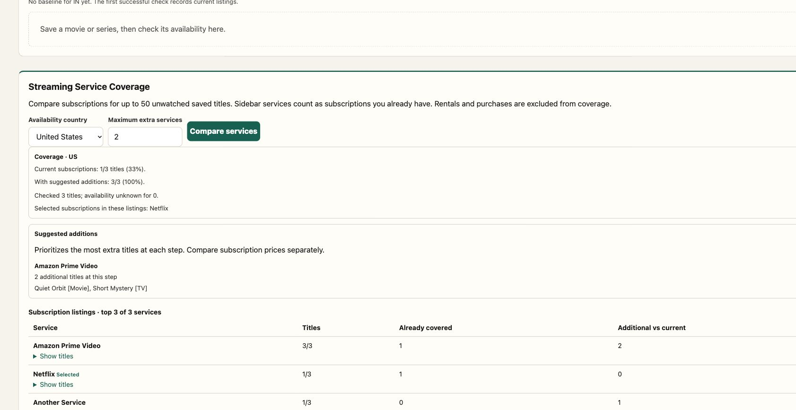

# Installation and coverage verification — 10 November 2026

## Scope

- Read-only source-checkout doctor, optional online API and Docker engine checks.
- Portable Node stdio launcher, retaining the existing shell entrypoint.
- Non-root Docker stdio build with an independent minimal runtime lockfile.
- Saved-watchlist subscription coverage in the browser, local MCP, and remote MCP.

## Passed checks

| Boundary | Evidence |
| --- | --- |
| Build and offline tests | `npm test`: concierge, planning/history, Radar, coverage, doctor, and launcher tests passed. |
| Doctor offline | Reported current build, configured key with value hidden, client references, Docker engine, and 27-tool MCP discovery. |
| Doctor online behavior | Fixtures verified a valid genre response, rejected credentials, and an unexpected HTTP-200 payload; offline mode made no API call. |
| Environment loading | Explicit environment precedence and literal parsing were verified; shell expressions in env data were not executed. |
| HTTP and remote MCP | Auth, CORS, validation, coverage results, and the remote tool passed against the planning fixture. |
| Docker build | Built `mcp-server-tmdb:local` on Docker Desktop/ARM64, with Node 22. |
| Container protocol/workflow | Stdio handshake discovered 27 tools; `plan_streaming_coverage` ran inside the container against the supplied fixture. |
| Image contents | Runtime UID 1000; no `/app/.env`, git history, or `agents` dependency. SDK 1.32.2 and Zod 4.6.7 were present. |
| Container runtime audit | `npm audit --omit=dev --prefix docker` reported zero known advisories at verification time. |
| Browser coverage | Three saved movie/TV titles: selected Netflix covered 1/3; adding Prime Video covered 3/3; overlap and per-title details were shown. These are synthetic fixture listings. |
| Browser constraints | Zero additions kept coverage at 1/3. Missing-country data reported three unknown titles without a false zero-coverage percentage. |
| Narrow layout | A requested 390px viewport (355 CSS pixels at the browser's existing zoom) had matching viewport/document width, without horizontal document overflow. The viewport override was reset. |
| Cloudflare version preview | Live 27-tool contract and all workflow smoke calls passed, including `plan_streaming_coverage`. This version was not promoted to production. |

## Local network limitation

An earlier live doctor check reached TMDB successfully. The final online doctor run reported
that TMDB could not be reached; it did not misclassify the failure as a bad key. Direct local
TMDB connectivity has been intermittent in this environment. The version preview's live
workflow smoke succeeded. The doctor intentionally reports a failed readiness check when
its own network request fails.

## Dependency findings

At the installation/coverage checkpoint, the root production graph reported 19 advisories,
including one critical; the separate container runtime reported zero. The subsequent
[security and CI update](security-ci-verification.md) upgrades SDK/Zod/build tooling and
removes the unused Cloudflare framework, bringing all three npm audit scopes to zero
known findings on 10 November 2026. These dated results do not establish that the
application or operating-system image is vulnerability-free.

## Reproduction

```bash
npm test
npm run doctor -- --online --docker
npm run docker:build
npm run smoke:docker
npm audit --omit=dev --prefix docker
```

For fixture HTTP/container checks, start the server and Worker using
[planning verification](planning-verification.md), then run:

```bash
node scripts/planning-http-test.mjs
npm run smoke:docker -- mcp-server-tmdb:local --fixture-base-url http://host.docker.internal:8791
```

To reproduce the browser comparison, save Neon Case (movie 101), Quiet Orbit (movie 102),
and Short Mystery (TV 101) from the fixture UI. Select Netflix, open My Watchlist, and set
coverage country to US. Set the fixture server to coverage mode:

```bash
curl -X POST 'http://127.0.0.1:8791/__fixture/radar-mode?mode=coverage'
```

Choose Compare services. Use `mode=missing` to check unknown handling. The fixture control
is test-only and does not exist in the production Worker.


